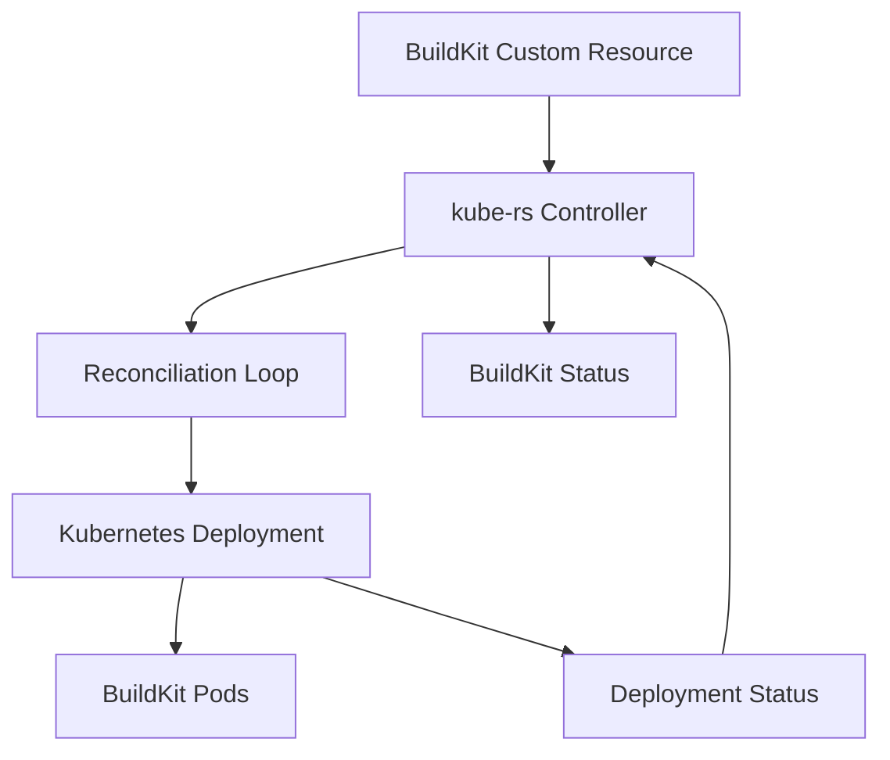

# BuildKit Operator

A Kubernetes operator written in **Rust using [kube-rs](https://github.com/kube-rs/kube)** to declaratively manage BuildKit instances.

The operator introduces a `BuildKit` Custom Resource Definition (CRD) that enables Kubernetes-native management of BuildKit Deployments, including automatic reconciliation, self-healing, and status reporting.

> **Project status:** Early development. Not yet intended for production or untrusted multi-tenant builds.

## Features

- **Declarative management** — Define BuildKit instances using Kubernetes custom resources.
- **Automatic reconciliation** — Create and update Deployments based on the desired configuration.
- **Self-healing** — Detect and recover from manual changes or deletion of owned Deployments.
- **Server-Side Apply (SSA)** — Manage Kubernetes resources through declarative API operations.
- **Owner references** — Automatically garbage-collect Deployments when their parent BuildKit resource is deleted.
- **Rootless BuildKit** — Run BuildKit using the rootless container image.
- **Status conditions** — Track readiness, rollout progress, and observed generations.
- **Custom printer columns** — Display BuildKit status using `kubectl get buildkits`.

## Architecture



The operator uses an event-driven reconciliation model. It watches `BuildKit` resources and their owned Deployments, ensuring the actual cluster state converges toward the desired configuration.

### Technology stack

| Component | Technology |
|---|---|
| Language | Rust |
| Operator framework | kube-rs 5.0 |
| Kubernetes API types | k8s-openapi |
| Async runtime | Tokio |
| Serialization | Serde |
| CRD schema generation | Schemars |
| Build engine | Moby BuildKit |

## Prerequisites

- Rust and Cargo
- A Kubernetes cluster
- `kubectl` configured with access to the cluster
- GNU Make or compatible Make implementation
- Permissions to create CRDs and manage the required Kubernetes resources

## Getting Started

### 1. Clone the repository

```bash
git clone <repository-url>
cd buildkit-operator
```

### 2. Generate and install the CRD

Generate the Kubernetes CRD manifest:

```bash
make gen-crd
```

Install it into the cluster:

```bash
make apply-crd
```

Verify the CRD:

```bash
kubectl get crd buildkits.buildkit.cleoverse.net
```

### 3. Run the operator

Start the operator locally using your current Kubernetes context:

```bash
make dev-operator
```

The operator connects to the Kubernetes API using the credentials discovered by `Client::try_default()`.

#### Run with an in-cluster ServiceAccount

Apply the operator identity and permissions:

```bash
kubectl apply -f config/rbac.yaml
```

This creates the `buildkit-operator` ServiceAccount in `default` and binds it to a ClusterRole. The controller watches BuildKit resources and Deployments across all namespaces. Its role permits reading those resources, applying Deployments, patching BuildKit status, and setting blocking owner references.

The operator Deployment in `config/deployment.yaml` uses this ServiceAccount. BuildKit worker Pods do not need it. Local runs continue to use your Kubernetes credentials.

CRD installation requires separate administrator permissions. The operator role grants no access to Secrets, Pods, events, or CRD installation.

#### Build the operator image

Build the image for your Docker host's architecture:

```bash
docker build -t buildkit-operator:local .
```

The multistage build compiles only the operator and copies its release binary into a non-root Distroless runtime. Docker BuildKit caches Cargo downloads and compilation artifacts between builds.

Load `buildkit-operator:local` into your Kubernetes cluster. For a registry image, push it and update `image` in `config/deployment.yaml` before deployment.

After installing the CRD and making the image available, deploy the operator using the manifests in `config/`:

```bash
kubectl apply -f config/
kubectl rollout status deployment/buildkit-operator -n default
```

The Deployment runs one replica in `default` with `imagePullPolicy: IfNotPresent`. It uses the `Recreate` strategy to avoid overlapping operator Pods during updates, since the controller has no leader election. Use these same manifests for future deployments.

Set the container's `RUST_LOG` environment variable to override the application's logging defaults. The image contains no shell or `crdgen` binary.

### 4. Create a BuildKit instance

Create `example.yaml`:

```yaml
apiVersion: buildkit.cleoverse.net/v1alpha1
kind: BuildKit
metadata:
  name: example
  namespace: default
spec:
  image: moby/buildkit:rootless
  replicas: 1
```

Apply the resource:

```bash
kubectl apply -f example.yaml
```

Verify the custom resource:

```bash
kubectl get buildkits
```

Example output:

```text
NAME      READY   REPLICAS   PROGRESSING
example   True    1          False
```

Check the generated Deployment:

```bash
kubectl get deployment example-buildkit
kubectl get pods -l app=example
```

## Develop with Tilt

Use the [Tilt development guide](dev/README.md) to run the operator and an example BuildKit instance on the development k3s cluster with automatic image rebuilds and Kubernetes rollouts. Complete the one-time registry setup before running `tilt up`.

## Custom Resource Specification

### BuildKit

| Field | Type | Description |
|---|---|---|
| `spec.image` | string | BuildKit container image |
| `spec.replicas` | integer | Desired Deployment replica count |

### Status

| Field | Description |
|---|---|
| `status.readyReplicas` | Number of ready BuildKit replicas |
| `status.observedGeneration` | Latest BuildKit resource generation processed |
| `status.conditions` | Current readiness and rollout conditions |

### Conditions

The operator currently supports:

- `Ready` — Indicates whether all desired BuildKit replicas are updated and available.
- `Progressing` — Indicates whether the Deployment is still rolling out.

A successful rollout typically reports:

```yaml
status:
  readyReplicas: 1
  observedGeneration: 1
  conditions:
    - type: Ready
      status: "True"
      reason: DeploymentReady
    - type: Progressing
      status: "False"
      reason: RolloutComplete
```

Readiness currently reflects Kubernetes Deployment health. It does not guarantee that an end-to-end BuildKit build has succeeded.

## Reconciliation and Self-Healing

The controller uses Kubernetes Server-Side Apply to synchronize the desired Deployment configuration.

It watches:

1. `BuildKit` custom resources for specification changes.
2. Owned Deployments for changes or deletion.

### Example: Replica reconciliation

Update the desired replicas:

```bash
kubectl patch buildkit example \
  --type merge \
  -p '{"spec":{"replicas":2}}'
```

The operator automatically updates the corresponding Deployment.

### Example: Self-healing

Manually modify the Deployment:

```bash
kubectl scale deployment example-buildkit --replicas=4
```

The operator detects the difference and restores the replica count to the value specified in the BuildKit custom resource.

### Example: Deployment recovery

Delete the managed Deployment:

```bash
kubectl delete deployment example-buildkit
```

As long as the parent `BuildKit` resource exists and the operator is running, the Deployment will be recreated.


### Debugging

Run the operator:

```bash
RUST_LOG=debug make dev-operator
```

Note that structured debug logging requires the corresponding tracing or logging subscriber configuration.

Inspect the BuildKit resource:

```bash
kubectl describe buildkit example
```

Inspect the Deployment:

```bash
kubectl describe deployment example-buildkit
```

Inspect BuildKit logs:

```bash
kubectl logs deployment/example-buildkit -c buildkitd
```

## References

- [kube-rs](https://github.com/kube-rs/kube)
- [Moby BuildKit](https://github.com/moby/buildkit)
- [Docker Buildx](https://docs.docker.com/build/builders/)
- [Kubernetes Operators](https://kubernetes.io/docs/concepts/extend-kubernetes/operator/)
- [Kubernetes Server-Side Apply](https://kubernetes.io/docs/reference/using-api/server-side-apply/)
